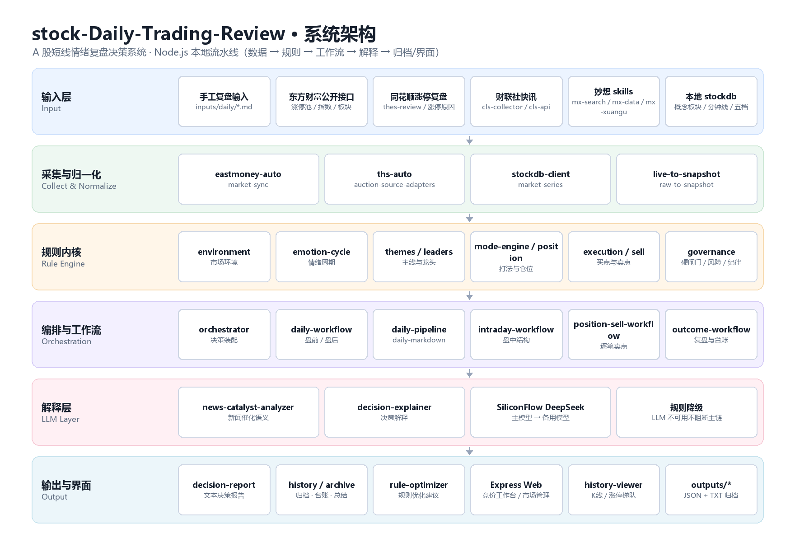
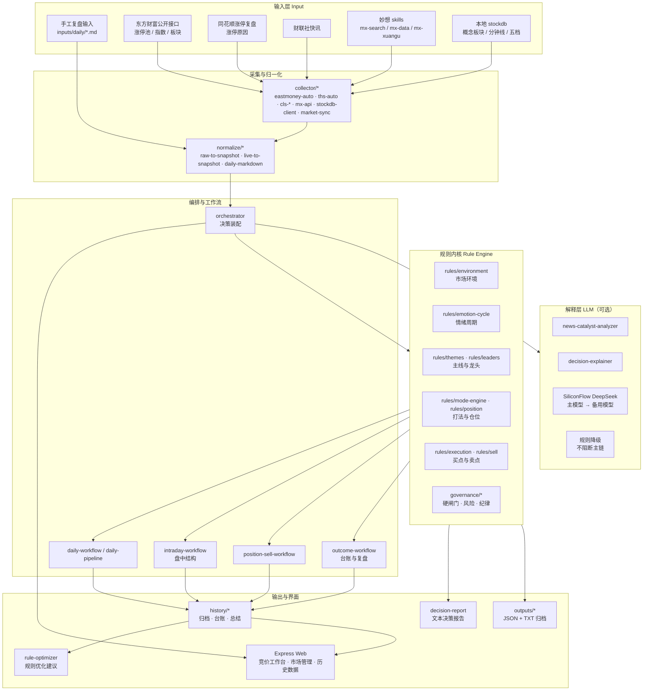
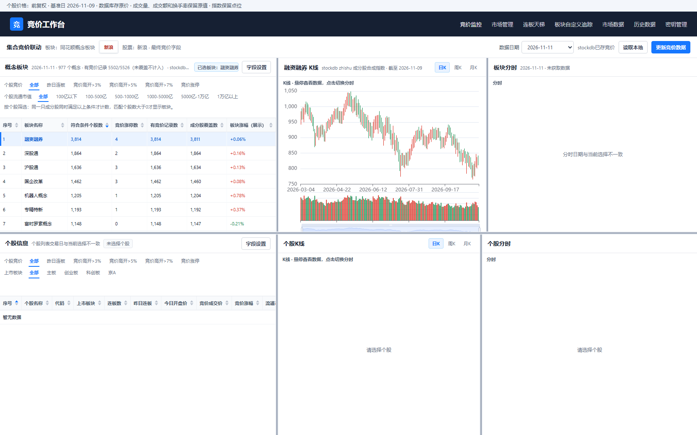
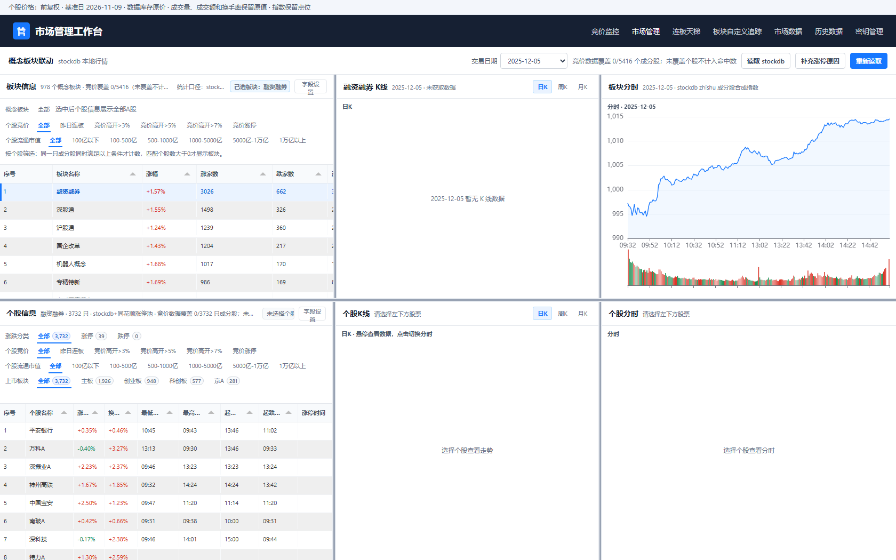
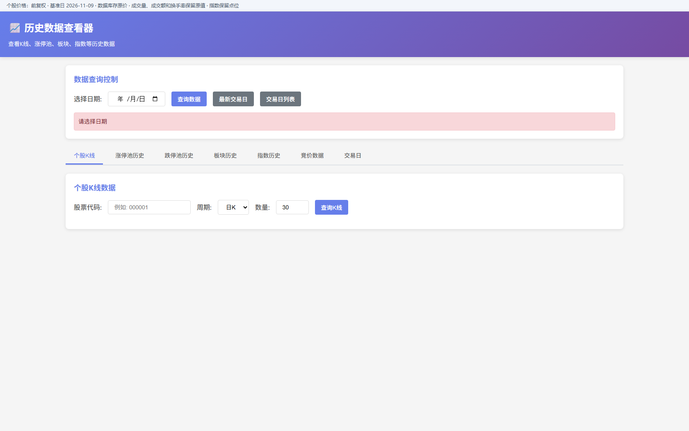

# 股票每日交易复盘 · A 股短线情绪自动分析决策系统

**English:** A local-first Node.js decision-support system for A-share short-term sentiment trading — it turns public market data and your own daily notes into a structured regime → emotion-cycle → theme/leader → position-gate → buy/sell-point decision, then archives the result for review. LLM layer only explains decisions; rule gates always win.

[](LICENSE)
[](https://github.com/Swellyhow/stock-Daily-Trading-Review/actions/workflows/ci.yml)
[](https://nodejs.org/)
[](#系统架构)
[](.github/PULL_REQUEST_TEMPLATE.md)

> 本项目是**决策与复盘辅助工具**，不接券商下单接口，不构成任何投资建议。所有输出都是"计划 + 依据 + 闸门"，最终决策与风险由使用者承担。

---

## 目录

- [项目简介](#项目简介)
- [系统架构](#系统架构)
- [运行截图](#运行截图)
- [适用场景](#适用场景)
- [功能边界与已知限制](#功能边界与已知限制)
- [快速开始](#快速开始)
- [命令行模式速查](#命令行模式速查)
- [Web 界面与 API](#web-界面与-api)
- [数据与归档](#数据与归档)
- [目录结构](#目录结构)
- [维护记录](#维护记录)
- [敏感数据与合规](#敏感数据与合规)
- [第三方组件与许可](#第三方组件与许可)

---

## 项目简介

A 股短线交易的核心难点不是"看图形"，而是每天开盘前把**环境、情绪、主线、龙头、仓位、买点禁区**这六件事按固定顺序想清楚，并在收盘后诚实地记录执行偏差。本仓库把这套流程工程化：

- **规则先行**：市场环境、情绪周期、主线题材、龙头梯队、打法模式、仓位上限、买点/禁止项、独立卖点引擎，全部是可读、可调参的本地规则（`src/lib/rules/`、`src/lib/governance/`）。
- **硬闸门兜底**：`dataQuality.confidence < 0.45` 直接 `hard-stop` 输出"停止出手 / 空仓"；`0.45 ~ 0.60` 只允许保守结论；没有明确主线或关键数据缺失时禁止主动进攻。LLM 只能解释结论，不能绕过闸门。
- **多源采集 + 分级降级**：东方财富公开接口（基础层）→ 妙想 skills（增强层）→ 财联社/同花顺（资讯与复盘）→ 本地 `stockdb`（板块/分钟/五档）。任一环节失败只降级，不阻断主链路。
- **闭环复盘**：盘前计划、盘中结构、盘后复盘、逐笔 outcome、持仓卖点计划全部落盘归档，并由 `rule-optimizer` 按 `setup × environment / theme / position / entryStyle` 给出"保留 / 收紧 / 禁用 / 观察"的规则建议。
- **本地优先**：数据、归档、密钥、界面都在本机；仅在你显式配置 Key 时才调用外部 LLM。

主要能力清单：

| 维度 | 能力 |
| --- | --- |
| 环境判断 | 涨停/跌停家数、连板高度、主线集中度、炸板率、昨日强股反馈、次日溢价、指数共振、风格（大票/小票）匹配 |
| 情绪周期 | 冰点 / 启动 / 发酵 / 高潮 / 退潮 定位与"能不能做"结论 |
| 题材与个股 | 主线题材识别、龙头 / 题材龙头 / 容量核心 / 中军 / 核心池 / 风险名单 |
| 交易执行 | 标准买点、禁止项、打法模式（连板接力 / 首板 / 低吸 / 防守轮动）、仓位与硬闸门 |
| 卖出 | 独立卖点引擎、逐笔持仓卖点计划（冲高兑现 / 保留核心观察仓 / 破位止损） |
| 复盘 | 盘中六问、逐笔台账、纪律分、最大回撤、计划匹配率、规则优化建议 |
| 界面 | 竞价工作台、市场管理、涨停梯队、历史数据查看、K 线图表、新闻列表、key 管理 |
| 解释层 | 新闻催化语义分析 + 决策解释（SiliconFlow DeepSeek 主/备模型，失败降级本地规则） |

## 系统架构



分层与数据流（Mermaid 版本，GitHub 可直接渲染）：



**单向依赖**：`collector → normalize → rules/governance → workflow → report/history → web`。规则层不感知 IO，工作流不感知 HTTP，界面只读归档与 API；因此换数据源、换模型、换前端都不需要动规则内核。

## 运行截图

竞价工作台（实时五档、分时、自定义板块跟踪，本地 `stockdb` 桥接后可用）：



市场管理（涨停梯队、连板高度、涨停原因补全、板块联动）：



历史数据查看（K 线、涨停池/跌停池、板块、指数、竞价，支持非交易日自动回退）：



> 截图取自本地 `node web/search-server.js`（`http://127.0.0.1:3000`）的实际渲染结果；界面上的行情数值取决于本机 `src/data/market.db` 的同步状态。

## 适用场景

- **个人每日复盘自动化**：盘前一键生成"今天能不能做 / 做什么打法 / 上限多少仓"，盘后一键生成执行复盘与纪律分。
- **交易纪律训练**：把"计划外追涨""情绪退潮中的中位接力"这类禁止项固化成规则，让系统在你情绪上头时给出反对意见。
- **规则统计验证**：累积逐笔 outcome 后，用 `rule-optimizer` 检验某个 setup 在特定环境/题材/仓位下的真实胜率，避免凭印象改规则。
- **盘中监控辅助**：竞价工作台 + 分时 + 梯队页面，把"盯盘"收敛成少数几个关键信号。
- **LLM 语义催化实验**：用新闻标题 + 公告做题材催化打分，与纯盘面强度打分对照，评估语义层是否真的带来增量。
- **教学/研究素材**：规则参数、涨停类型量化定义、数据需求清单等文档可作为短线情绪体系的工程化样例（见 `docs/`）。

## 功能边界与已知限制

本系统**不是**以下东西，请明确预期：

1. **不是交易执行系统**：不接券商/期货下单接口，不自动报单，不托管资金。
2. **不保证数据完整性**：基础层依赖东方财富公开接口，接口改版、限流、停牌/新股/ST 规则变化都会影响涨停池与梯队统计；缺失时系统只会降低 `confidence` 并输出 `warnings`，不会编造数据。
3. **LLM 层是可选增强**：未配置 `SILICONFLOW_API_KEY` 时自动降级为本地规则解释，结论仍然可用，但语义催化与自然语言解释质量下降。
4. **本地 `stockdb` 是可选依赖**：板块 `.TI` 原生行情、分钟线、实时五档需要本地 `stockdb` 数据与桥接服务；缺失时相关接口返回降级结果。`npm test` 中有 3 个用例属于这一类（见 [`docs/TESTING.md`](docs/TESTING.md)）。
5. **原生模块编译**：`better-sqlite3` 需要与 Node ABI 匹配的预编译二进制或本地编译环境（Windows 需 VS Build Tools + C++ 工作负载）。仓库已验证 Node 24.18 + Windows 11。
6. **规则参数有市场前提**：所有阈值（连板高度、集中度、炸板率、溢价、共振分）针对 A 股主板短线情绪生态调校，直接套用到港股/美股/加密市场没有意义。
7. **回测能力有限**：`rule-optimizer` 做的是归档样本的分组统计（样本量小、存在选择偏差），不等价于严格意义上的策略回测。
8. **免责**：输出为决策辅助信息，不构成投资建议；实盘盈亏与合规责任由使用者承担。

## 快速开始

### 环境要求

- Node.js **≥ 20**（开发与验证环境：Node 24.18 / npm 11.x / Windows 11）
- PowerShell 5.1+（脚本以 `.ps1` / `.cmd` 提供，Linux/macOS 可直接用 `node` 命令）
- 可选：本地 [`stockdb`](docs/STOCKDB_INTEGRATION.md) 数据集（板块/分钟/五档能力）
- 可选：SiliconFlow API Key（LLM 解释层）

### 安装

```bash
git clone https://github.com/Swellyhow/stock-Daily-Trading-Review.git
cd stock-Daily-Trading-Review

# 1) 安装依赖
npm install

# 2) 准备环境变量（全部为可选能力，缺失即降级）
cp .env.example .env        # Windows: copy .env.example .env
# 按需填写 SILICONFLOW_API_KEY / CMES_TOKEN / IFIND_MCP_TOKEN 等

# 3) 语法自检
npm run check

# 4) 跑测试（47 个用例，其中 3 个需要本地 stockdb 数据集）
node --test "test/**/*.test.js"
```

`better-sqlite3` 若安装阶段编译失败，可只下载预编译二进制：

```bash
cd node_modules/better-sqlite3
npx prebuild-install -r node -t 24.18.0 -a x64
```

### 跑一次本地决策（不需要联网）

```bash
npm run analyze            # 用 data/examples/sample_snapshot.json 出决策
npm run report             # 原始盘面笔记 → 文本决策报告
npm run premarket          # 盘前计划
npm run postmarket         # 盘后复盘
npm run daily:md           # 从 inputs/daily/latest.md（Markdown 复盘）跑完整流水线
```

实际输出（节选，`npm run analyze --format text`）：

```text
Date: 2026-03-31
Environment: 进攻环境
Emotion Cycle: 启动
Primary Theme: 机器人
Preferred Mode: 连板接力
Style Preference: 防守轮动
Action Bias: 停止出手
Position Plan: 空仓
Data Confidence: N/A

Environment Basis: 涨停58家，跌停7家 | 连板高度5板，主线集中度0.68 | 炸板率0.18，昨日强股反馈0.45 ...
Allowed Setups: None
Forbidden Setups: 追后排跟风, 情绪退潮中的中位接力, 无预案主动追涨, 情绪化重仓试错, ...
```

> 注意这个例子本身就在演示"闸门优先"：环境判定为进攻环境、情绪处于启动，但因为没有通过允许买点的校验，`Action Bias` 最终收敛为 `停止出手 / 空仓`。

### 联网采集 + 自动分析

```powershell
powershell -ExecutionPolicy Bypass -File .\run-analysis.ps1 -Mode auto-live
powershell -ExecutionPolicy Bypass -File .\run-analysis.ps1 -Mode intraday-live
powershell -ExecutionPolicy Bypass -File .\run-analysis.ps1 -Mode daily-md -InputPath .\inputs\daily\latest.md
```

指定交易日：

```powershell
powershell -ExecutionPolicy Bypass -File .\run-analysis.ps1 -Mode auto-live -TradeDate 2026-03-31
```

### 数据同步

```bash
node sync-data.js status          # 查看本地库同步状态
node sync-data.js sync-today      # 同步当日行情（概念板块 / 指数 / 涨停池 / 财联社）
node sync-data.js sync-recent 30  # 回补最近 30 天
node sync-data.js sync-kline 000001 100
node sync-data.js help
```

实测输出：

```text
📊 同步今日市场数据...
[市场数据同步] 实际交易日: 2026-11-11
[市场数据同步] 概念板块: 383 个
[市场数据同步] 市场指数: 6 个
✅ 同步成功！ 板块: 383 个  指数: 16 个

数据库文件: src/data/market.db（已在 .gitignore 中排除）
```

### 启动 Web 界面

```powershell
# Windows：双击 start-project.cmd，或
powershell -ExecutionPolicy Bypass -File .\start-project.ps1
```

或直接起服务：

```bash
npm run web:data    # 统一 Web 服务 http://localhost:3000（竞价/市场管理/历史数据/新闻/图表）
npm run web         # 策略看板服务（历史归档渲染）
```

默认入口：`http://localhost:3000/auction-monitor.html`；策略看板：`http://localhost:3030/index.html`。

## 命令行模式速查

| 模式 (`--mode`) | 用途 | 输入 |
| --- | --- | --- |
| `analyze` | 直接对已归一化的 snapshot 出决策 | `data/examples/sample_snapshot.json` |
| `analyze-raw` / `normalize` | 原始盘面笔记 → snapshot → 决策 | `data/examples/raw_market_notes.json` |
| `premarket` / `archive-premarket` | 盘前计划（可选归档） | 同上 |
| `postmarket` / `archive-postmarket` | 盘后复盘（可选归档） | 同上 |
| `intraday` | 盘中结构信号分析 | `data/examples/intraday_signals.json` |
| `intraday-live` | 联网抓取盘中结构 | — |
| `auto-live` | 全自动联网采集 + 决策 + 归档 | — |
| `daily` / `daily-markdown` | 完整日流水线（JSON / Markdown 复盘） | `data/examples/daily_run.*` |
| `outcome` / `archive-outcome` | 逐笔成交复盘 / 归档 | `data/examples/trade_outcome.json` |
| `archive-outcome-batch` | 批量台账归档 | `data/examples/trade_outcome_batch.json` |
| `position-sell` | 逐笔持仓卖点计划 | `data/examples/position_sell_input.json` |
| `history-summary` | 历史归档统计汇总 | — |

通用参数：`--input <file>`、`--format text|json`、`--date YYYY-MM-DD`。

## Web 界面与 API

| 页面 | 说明 |
| --- | --- |
| `/auction-monitor.html` | 竞价工作台：实时五档、分时、自定义板块跟踪 |
| `/market-management.html` | 市场管理：涨停梯队、连板高度、涨停原因、板块联动 |
| `/limit-up-ladder.html` | 涨停梯队视角 |
| `/history-viewer.html` | 历史数据：K 线 / 涨停池 / 跌停池 / 板块 / 指数 / 竞价 |
| `/chart-viewer.html` | K 线图表（含分时与 tooltip） |
| `/data-viewer.html` | 实时原始数据查看 |
| `/news-list.html`、`/search.html` | 财联社新闻列表与检索 |
| `/key-management.html` | 本地 Key 管理（Token 仅存本机） |

核心 API（详见 [`docs/数据同步系统使用指南.md`](docs/数据同步系统使用指南.md)）：

```text
GET /api/raw-data
GET /api/history/kline?code=000001&limit=100
GET /api/history/limit-up?date=2026-04-26
GET /api/history/limit-down?date=2026-04-26
GET /api/history/sector?date=2026-04-26
GET /api/history/index?date=2026-04-26
GET /api/history/auction?date=2026-04-26
GET /api/history/trading-dates?limit=100
GET /api/history/sync-status
GET /api/cmes/quotes?codes=601212,000001      # 需本地 stockdb 桥接 + Token
```

历史接口支持**交易日自动回退**：查询非交易日时返回最近有数据的交易日，并在响应中标注 `isFallback: true`。

## 数据与归档

- `src/data/market.db`：本地 SQLite（K 线、涨停池、跌停池、板块、指数、竞价、新闻），`*.db` 已排除出版本控制。
- `outputs/`：决策、计划、复盘、台账、规则优化结果。**默认不纳入版本控制**（见 `.gitignore`），仓库内仅保留脱敏演示产物（标的名为 `机器人龙头A` / `AI核心C` 这类占位符）。
- `inputs/`：个人每日复盘原文（Markdown），同样不入库。
- 归档结构示例：

```text
outputs/
├── daily/2026-03-31/{decision,premarket,postmarket,snapshot,outcome,rule-optimizer}.{json,txt}
├── history/index.json          # 归档索引
├── history/samples.json        # 逐笔样本台账
├── history/dashboard.{json,txt}
└── history/rule-optimizer.{json,txt}
```

## 目录结构

```text
stock-Daily-Trading-Review/
├── src/
│   ├── index.js                 # CLI 入口（模式分发）
│   ├── web-server.js            # 策略看板服务
│   └── lib/
│       ├── collector/           # 东财/同花顺/财联社/妙想/stockdb 采集
│       ├── normalize/           # 各类输入 → snapshot
│       ├── rules/               # 环境/情绪/题材/龙头/模式/仓位/执行/卖点
│       ├── governance/          # 硬闸门、交易风险、执行纪律
│       ├── workflow/            # 盘前/盘后/盘中/卖点/台账工作流
│       ├── llm/                 # 新闻催化、决策解释（可降级）
│       ├── history/             # 归档、台账、统计、规则优化
│       ├── report/              # 文本报告格式化
│       ├── knowledge-base/      # 游资知识库检索
│       └── web/                 # 看板数据装配
├── web/                         # Express 路由 + 前端页面
├── test/                        # node:test 用例（47 个）
├── scripts/                     # stockdb 更新、校验、浏览器自测脚本
├── data/{templates,examples}/   # 输入模板与脱敏示例
├── docs/                        # 设计与功能文档 + 截图 + 架构图
├── 游资知识库/                   # 方法论笔记（授权状态见 THIRD_PARTY_NOTICES.md）
├── skills/                      # 可选 alphaear-* 技能包（Apache-2.0）
├── run-analysis.ps1 / start-project.cmd / stop-project.cmd
├── sync-data.js
├── CHANGELOG.md / ROADMAP.md
└── LICENSE（MIT）+ THIRD_PARTY_NOTICES.md
```

## 维护记录

| 记录 | 位置 |
| --- | --- |
| 版本更新说明 | [`CHANGELOG.md`](CHANGELOG.md) |
| 开发路线图 | [`ROADMAP.md`](ROADMAP.md) |
| 实际开发记录（按归档产物与提交回溯） | [`docs/DEVLOG.md`](docs/DEVLOG.md) |
| 测试结果与复现方式 | [`docs/TESTING.md`](docs/TESTING.md) |
| 敏感数据检查报告 | [`docs/SECURITY_AUDIT.md`](docs/SECURITY_AUDIT.md) |
| Issue / PR 模板 | `.github/ISSUE_TEMPLATE/`、`.github/PULL_REQUEST_TEMPLATE.md` |
| CI（语法 + 单元测试） | [`.github/workflows/ci.yml`](.github/workflows/ci.yml) |

近期提交：

```text
5ea9afa  2026-11-11  fix(db): wait on busy_timeout instead of failing on parallel test access
394bc6f  2026-11-11  chore(opensource): add MIT license, project docs, CI and sensitive-data cleanup
1ef9439  2026-09-21  Fix consecutive limit-up board counts
3346173  2026-09-11  Initial public snapshot
```

CI 状态：Node 20/22/24 × Ubuntu/Windows 六个 job 全绿（`run 43004841929`）。

## 敏感数据与合规

- 仓库内**不含**真实 API Key：`.env` 被忽略，`.env.example` 仅含占位符；`git grep` 未发现 `sk-*` / `ghp_*` / `Bearer <token>` 形态的密钥。
- 仓库内**不含**个人交易流水与身份信息：`outputs/` 中的台账为脱敏占位标的，`positionPct` 均为示例值。
- 行情快照（`auto-live.json` 等大文件）与运行日志已从版本控制中移除，`.gitignore` 已覆盖 `outputs/`、`inputs/`、`*.db`、`*.log`。
- 完整检查项、证据与后续动作见 [`docs/SECURITY_AUDIT.md`](docs/SECURITY_AUDIT.md)。
- 若你需要清理历史提交中的旧文件（GitHub 上仍可通过旧 commit 访问），按报告中的 `git filter-repo` 步骤处理。

## 第三方组件与许可

本项目主体以 **MIT** 发布。仓库内包含：

- `skills/Awesome-finance-skills-main/`：上游 [RKiding/Awesome-finance-skills](https://github.com/RKiding/Awesome-finance-skills)，**Apache-2.0**，原许可文件保留；
- `.codex/skills/mx-*`：东方财富妙想技能示例（本地集成，无密钥）；
- `游资知识库/*.md`：作者整理的方法论笔记，**再分发授权待确认**；
- 行情/资讯数据来自东方财富、同花顺、财联社、stockdb、妙想 API，再分发受各数据方条款约束。

细节见 [`THIRD_PARTY_NOTICES.md`](THIRD_PARTY_NOTICES.md)。

## 许可

[MIT](LICENSE) © 2026 Swellyhow

欢迎 Issue / PR。提交前请先读 [`docs/TESTING.md`](docs/TESTING.md) 与 [`.github/PULL_REQUEST_TEMPLATE.md`](.github/PULL_REQUEST_TEMPLATE.md)，说明改动动机、影响的规则/接口以及验证方式。
